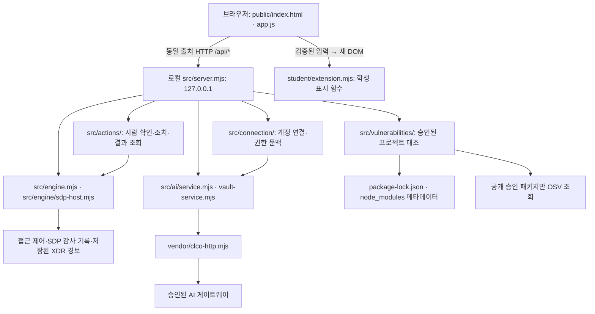

# 크립테아 학생 실행 설명서와 시스템 구성도

기준: 2026-10-23, 시작 틀 `alekov-client-starter` 0.2.11, 학생 구현 13~20단계. 이 문서는 21단계의 학생 작성 문서입니다. 직원이 본인의 로그인 사용자·기기·세션, 업무 앱 접근 판정, 최근 보안 기록을 확인하는 앱입니다. AI 설명은 참고 정보이며 조치 실행이나 공식 과제 판정이 아닙니다.

## 1. 준비와 지원 환경

| 항목 | 코드·문서 기준 | 이번에 실제 확인한 값 |
|---|---|---|
| 운영체제 | 제공 실행 도구는 Windows PowerShell용. Native 계정 연결도 Windows 전용 | Windows 환경에서 파일·명령 확인. 다른 OS 실행은 미확인 |
| PowerShell | 제공 도구 `tools/start-alekov.ps1` 실행 | Windows PowerShell 5.1.26100.9711 |
| Node.js | `package.json` engines는 24.19.0, 실행 도구의 허용 주 버전은 22~24 | 기본 `node`는 v20.9.0으로 허용 범위 밖. 별도 런타임은 v24.22.1. 이 두 값은 기준 버전과 다름 |
| Git | 커밋 및 원문 JSON 생성에 필요 | 2.37.2.windows.2 |
| 브라우저 | 로컬 HTTP 페이지를 열 수 있는 PC 브라우저. 메뉴 확인은 1280px 이상 | 이번 문서 작성에서 실제 브라우저 조작은 미확인 |
| 패키지 | 외부 npm 의존성 선언 없음 | 현재 `package-lock.json`과 `node_modules`는 실행 준비 과정에서 생성하지 않음. 실제 설치 버전 대조는 미확인 |

기본 Node.js v20.9.0으로 실행하면 실행 도구가 중단합니다. 먼저 지원 버전이 선택되는 환경을 준비하고 새 PowerShell에서 `node --version`을 확인하세요. 전역 환경이나 설치 프로그램을 이 문서가 자동 변경하지 않습니다. 22~24 전체 버전의 동작을 시험한 것은 아닙니다.

## 2. 위치와 폴더 구조

현재 Git 최상위(커밋·원문 도구 실행 위치):

```text
C:\Users\kimgu\OneDrive\바탕 화면\projects\alekov-starter-0.2.11
```

앱 실행 위치는 그 안의 `on-client`입니다. 다른 PC에서는 본인이 복사한 프로젝트의 실제 경로로 바꿉니다.

```text
alekov-starter-0.2.11/
  on-client/
    README.md
    package.json                 실행 스크립트·시작 틀 버전
    .env.example                 비밀 없는 설정 설명 견본
    tools/start-alekov.ps1       제공 실행 도구
    public/index.html           크립테아 제목과 제공 화면
    public/app.js               제공 UI·조회·취소·입력 검증·학생 DOM 교체
    public/vulnerabilities-view.mjs  제공 패키지 결과 검증·표시
    student/extension.mjs       학생 표시 함수
    student/engine-adapter.mjs  기본 엔진 어댑터
    src/server.mjs             로컬 앱 서버
    src/engine/                SDP 호스트 연결
    src/connection/            계정 연결·호스트 문맥
    src/ai/                    AI 연결·권한·설명 처리
    src/actions/               제공 조치 처리·결과 관리
    src/vulnerabilities/       프로젝트 대조·OSV 조회
    vendor/clco-http.mjs        서버의 AI 게이트 전송 모듈
    api/index.mjs              공개 조회용 Vercel 미리보기 어댑터
    vercel.json                해당 미리보기 배포 설정
    docs/STUDENT_RUNBOOK.md     이 학생 문서
```

`package-lock.json`은 현재 앱 폴더에 없습니다. 실 조회 대상은 운영자가 승인한 프로젝트이며, 학생이 경로나 공개 패키지 허용 목록을 임의로 추가하지 않습니다.

## 3. 시작·정상 신호·중지·재실행

1. 파일 탐색기에서 `on-client`를 열고 주소 표시줄에 `powershell`을 입력합니다. 아래 위치에서도 열 수 있습니다.

```powershell
Set-Location -LiteralPath 'C:\Users\kimgu\OneDrive\바탕 화면\projects\alekov-starter-0.2.11\on-client'
node --version
```

이 PC에서 확인한 별도 런타임을 사용하려면, 위에서 새로 연 창에 한해 다음을 실행할 수 있습니다. 경로가 다른 PC에 있다고 가정하지 않습니다. 창을 닫으면 이 창의 PATH 변경은 끝나며 전역 설정은 바뀌지 않습니다.

```powershell
$kripteaNodeDirectory = 'C:\Users\kimgu\.cache\codex-runtimes\codex-primary-runtime\dependencies\node\bin'
$env:Path = $kripteaNodeDirectory + ';' + $env:Path
node --version
```

이번 확인 값은 v24.22.1이며 수업 기준 v24.19.0과 다릅니다. 다른 PC에서는 본인에게 설치된 지원 Node.js 경로를 사용합니다.

2. 지원 Node.js가 선택된 것을 확인하고 제공 실행 도구를 실행합니다. 외부 npm 의존성이 없어 현재 프로젝트의 기본 실행에 `npm install`을 추가하지 않습니다.

```powershell
powershell -NoProfile -ExecutionPolicy Bypass -File .\tools\start-alekov.ps1
```

3. 브라우저에서 `http://127.0.0.1:5189/`를 엽니다. 실행 도구가 HTTP 200을 확인하면 다음 문장을 출력합니다.

```text
케셰브가 켜졌습니다. 브라우저에서 http://127.0.0.1:5189/ 을 여세요.
서버가 응답한 것만 확인했습니다. AI 연결 상태는 화면에서 따로 확인해 주세요.
```

실행 도구의 기본 이름 메시지는 제공 원문 그대로입니다. 앱 이름은 **크립테아**이며 이 메시지에 맞춰 이름을 되돌리지 않습니다. 서버 시작 신호는 계정·SDP·AI 연결 성공을 뜻하지 않습니다. 브라우저에서는 크립테아 제목과 보호 현황·업무 앱·보안 기록 메뉴를 확인합니다. 기본 실행은 외부 시스템 미연결입니다.

4. 기본 포트가 사용 중이면 기존 프로그램을 종료하지 말고 다음처럼 다른 포트를 사용합니다. 브라우저 주소도 `http://127.0.0.1:5190/`으로 바꿉니다.

```powershell
powershell -NoProfile -ExecutionPolicy Bypass -File .\tools\start-alekov.ps1 -Port 5190
```

5. 일반 실행은 실행한 창에서 Ctrl+C로 중지합니다. 해당 주소가 응답하지 않는지 확인합니다. 재실행은 같은 폴더에서 같은 시작 명령을 사용합니다. 기본 포트의 시작·Ctrl+C·재실행을 이번 문서 작성에서 직접 시험한 것으로 기록하지 않습니다.

선택 사항: `-Background`로 실행하면 도구가 출력한 프로세스 번호의 node를 작업 관리자에서 종료합니다. 다른 node나 다른 프로젝트를 종료하지 않습니다. `-Demo`는 예제 자료이며 실제 연결을 인증하지 않습니다. `npm start`는 `node src/server.mjs`, `npm run demo`는 같은 서버의 `--demo`, `npm run check`는 학생 파일 문법 검사입니다. 직접 npm 실행에는 제공 도구의 사전 검사·환경변수 제거가 적용되지 않습니다.

## 4. 설정 경계

기본 실행에는 키 입력이 필요하지 않습니다. `.env.example`은 설정 견본이며 복사만으로 연결되지 않습니다. 실행 도구는 비밀로 보이는 환경변수와 `ON_AI_` 환경변수를 자식 서버에 넘기지 않습니다. 서버가 `.env`를 자동 읽는다고 가정하거나 실행 도구의 보호 필터를 제거하지 않습니다.

실제 연결은 담당자가 발급·안내한 별도 `-NativeHostConfig`(계정·AI 호스트), `-SdpHostConfig`(접근 제어·보안 기록 호스트)가 필요합니다. 실행 도구의 해당 옵션이 각각 서버의 `--native-host-config`, `--sdp-host-config`로 전달됩니다. 설정 파일은 프로젝트·Git·JSON 밖에 보관하고 내용·키·토큰·비밀번호를 문서나 채팅에 넣지 않습니다. 담당자에게 실제 파일 경로를 안내받기 전에는 추측한 경로로 실행하지 않습니다. `-Demo`와 SDP 설정은 함께 쓸 수 없습니다. 자세한 제공 계약은 [SDP_HOST_CONNECTION.md](SDP_HOST_CONNECTION.md), [AI_SETUP_GUIDE.md](AI_SETUP_GUIDE.md)를 참조합니다.

## 5. 글로 쓴 시스템 구성도



이 그림은 구현된 경로의 관계이며 실제 외부 연결 성공 기록이 아닙니다. 브라우저는 앱 서버에 요청하고 서버가 계정·권한·입력·결과를 검증합니다. 학생 함수는 전달된 입력을 표시하며 직접 게이트웨이·OSV·조치 서버를 호출하지 않습니다. XDR은 저장된 경보를 조회하며 브라우저에서 새로 탐지하지 않습니다. OSV 공개 조회 출처는 `https://api.osv.dev/v1/querybatch`입니다. 비공개 패키지 이름은 외부로 보내지 않습니다.

SDP 대상·실제 게이트 주소·자격은 이 문서에 적지 않습니다. 위 SDP·AI·조치 화살표는 정식 설정과 권한이 준비되어야 동작하며 실제 학생 계정 조치 집행은 미완료·미확인(UNV)입니다. AI 모델 목록 점검은 사건 설명 실행이 아닙니다. 수업용 코딩 AI, 앱 내부 설명 AI, ALEPH 공식 과제 판정 AI는 역할이 다릅니다.

공개 주소 `https://alekov-starter-0-2-11.vercel.app/`는 `api/index.mjs`와 `vercel.json`의 조회용 미리보기입니다. 허용된 GET만 전달하며 POST는 `405 PREVIEW_READ_ONLY`입니다. 로컬 계정 연결·유료 AI 설명·조치 집행을 이 미리보기에서 확인했다고 쓰지 않습니다. 현재 로컬 커밋과 배포 사이트 버전의 일치는 이번 단계에서 확인하지 않았습니다.

## 6. 학생 작성과 제공 코드, 검증 범위

| 단계·학생 함수 | 학생이 작성한 표시 | 확인 수준·남은 확인 |
|---|---|---|
| 13 `renderIdentity` | 계정·기기·세션, 상태 한국어와 원래 값 | 과거 코드·모의 검사. 현재 실제 계정 조회 미확인 |
| 14 `renderDecision` | 허용·거부·추가 확인·확인 불가·요청 실패, 이유·시각 | 과거 코드·모의 검사. 실제 앱 접속 성공을 보장하지 않음 |
| 15 `renderEvents` | 최근 본인 기록의 필터·정렬·근거·규칙·세 상태 | 과거 코드·모의 검사. 전체 직원·전체 이력·실시간 탐지 아님 |
| 16 `renderStatus` 및 기록 상세 | 알림·빈 목록·오류·안전 필드 복사, 미지원 비활성 안내 | 과거 모의 검사. 실제 클립보드·실제 조치 미확인 |
| 17 `renderAiConnection` | 연결 점검·권한·한도·취소와 수동 복구 안내 | 제출 피드백 8개 통과·실제 모델 호출 항목 확인 불가. 공식 전체 통과로 단정하지 않음 |
| 18 `renderExplanation` | 현재 근거와 연결된 참고 요약·규칙·unknown·미실행 제안 | 모의 DOM·코드 대조 133개 통과. 실제 유료 설명 미실행 |
| 19 `renderAction` | 준비·전송·ACK·효과 관측·결과 불명 구분 | 모의 DOM·코드 대조 1,011개 통과. 실제 집행·효과 재조회는 UNV |
| 20 `renderVulnerabilities` | 정확한 전달 버전·출처·시각·부분 결과·미조회 구분 | 모의 DOM·제공 검증기 147개 통과. 실제 OSV 조회·설치 버전 대조 미확인 |

제공 부분은 `public/app.js`의 메뉴·조회·취소·세대 검사·입력 검증·DOM 교체, `src/`의 서버·연결・AI·조치·OSV 처리, 실행 도구입니다. 이를 학생 구현 성취로 대신 계산하지 않습니다. 학생 함수는 `document.createElement`·`textContent`로 DOM을 반환하며 서버·인증·정책을 변경하지 않습니다. 화면 이름은 `public/index.html`에 크립테아로 반영되어 있으나 제공 실행 메시지·실행 파일명은 그대로입니다. 이번 21단계는 학생 문서와 README 안내만 변경합니다.

기기 보안 상태는 악성코드 검사·치료가 아닙니다. allow는 정책 판정이며 실제 앱 접속 보장이 아닙니다. AI 제안은 사람 확인·서버 요청·효과 관측과 다릅니다. ACK·unknown은 효과 확인이 아니며 취소는 이미 집행된 효과를 되돌리지 않습니다. OSV의 none_found는 조회 범위에 알려진 항목이 없다는 뜻입니다.

## 7. 오류별 확인·복구 순서

| 증상·코드 | 먼저 확인 | 복구·다음 확인 |
|---|---|---|
| Node.js 없음·지원 버전 아님 | 새 창의 `node --version` | 지원 버전을 준비하고 동일 명령 재실행. 현재 기본 v20.9.0은 사용하지 않음 |
| 앱 폴더 아님·실행 파일 없음 | 현재 위치와 `tools/start-alekov.ps1`, `src/server.mjs`, `package.json` | 파일을 덮어쓰지 말고 올바른 on-client에서 실행 |
| 포트 사용 중·시작 시간 초과 | 실행 도구 메시지, 선택 포트 | 다른 프로그램은 보존하고 `-Port 5190` 사용. 시간 초과는 비밀을 제외한 오류와 함께 담당자 확인 |
| `ENGINE_NOT_CONNECTED`·조회 실패 | 기본 미연결인지, 담당자 설정 준비 여부 | 제공 「다시 불러오기」로 직접 재시도. 성공 전까지 빈 결과·정상으로 처리하지 않음 |
| `NATIVE_HOST_DISABLED`·`ON_AI_PROVISIONING_PENDING` | 계정 연결·앱 권한·호스트 설정 준비 여부 | 담당자 확인. 열쇠 복사·임의 모델·대체 연결 추가하지 않음 |
| AI 인증·한도·시간 초과·취소 | 학생 연결 영역의 안전한 코드와 안내 | 인증·한도는 담당자 확인, 일시 오류는 제공 「AI 연결 점검」으로 수동 재시도. 모델 목록만으로 설명 성공 처리하지 않음 |
| `ON_AI_INVALID_INPUT`·`ON_AI_INVALID_OUTPUT` | 현재 기록의 근거·규칙과 설명 상태 | 설명을 사용하지 않고 기록 유지. 없는 근거를 만들어 맞추지 않음 |
| 조치 `pending`·`unknown`·`ACTION_TIMEOUT` | requestId·receiptId·version·관측 여부 | 제공 「원천 결과만 재조회」 사용. 다시 집행하거나 효과 없음으로 단정하지 않음 |
| `ACTION_CONFIRMATION_EXPIRED` | 대상과 확인 기한 | 제공 화면에서 다시 준비. 학생 코드에 티켓이나 집행 버튼 추가하지 않음 |
| 패키지 not_configured·not_checked | 대상 설정·공개 승인 목록 준비 여부 | 정상적인 미조회 가능. 담당자 확인, 임의 허용 목록·경로 변경 금지 |
| 패키지 partial·unverifiable·error | 현재 해시·시각·확인된 취약점 ID | 일부 ID 보존, 취약점 없음으로 해석하지 않음. 제공 「설치 패키지 조회」로 직접 재시도 |
| Vercel 405·미지원 주소 | 조회용 미리보기의 요청 제한 | 로컬 앱과 구분. 제한을 임의 해제하지 않음 |

보호 현황의 「도움정보 불러오기」는 제공 영역입니다. 학생 상태 영역의 「도움정보 복사」는 requestId·component·version·checkedAt·engine.mode·engine.code만 복사합니다. 내용은 보내기 전에 직접 확인하고 비밀번호·키·토큰은 포함하지 않습니다. 오류를 고치기 위해 기존 작업·Git 기록을 삭제하거나 origin을 바꾸지 않습니다.

## 8. 실제 확인과 미확인 기록

2026-10-23 실제 실행 검사: 이 PC의 별도 Node.js v24.22.1을 검사 프로세스의 PATH에만 선택하고, on-client에서 제공 도구를 `-Background -Port 5197`로 실행했습니다. 두 차례 시작 → HTTP 200 및 크립테아 제목 확인 → 이번에 시작한 프로젝트 서버 프로세스만 종료 순서로 재실행을 확인했습니다. 종료 후 해당 포트의 리스너가 없는 것도 확인했습니다. 별도 진단 응답은 engine.mode=disconnected, ai.configured=false였습니다. 기존 작업·포트 5189·전역 PATH·연결 설정은 변경하지 않았습니다.

자동 검사 중 Windows가 자식 서버 종료까지 기다리는 출력 수집 방식 때문에 지연이 있었습니다. 검사 방식에서 실행 도구 프로세스만 기다리도록 조정한 뒤 위 두 차례 검사를 통과했습니다. 앱 코드나 실행 도구를 수정해서 해결한 문제가 아닙니다. 표준 실행의 Ctrl+C와 실제 브라우저 조작은 이 검사로 인증하지 않습니다.

실행 도구 검사 결과는 이 문서 작성 중 얻은 실제 출력만 기재합니다. 기본 미연결에서 진단 응답을 받는 것은 실제 AI·SDP 연결 성공과 다릅니다. 브라우저를 통한 메뉴 이동·사람 확인·클립보드·유료 설명·실제 집행·OSV 조회·새 PC 재현은 이번 단계에서 미확인입니다. 과거 모의 검사 수는 해당 단계의 시점 기록이며 공식 통과 인증이 아닙니다.

직접 확인은 한 번에 하나씩 진행합니다. 먼저 기존 작업을 보존한 새 PowerShell 창에서 3장의 실행 절차를 따라 하고 정상 시작 신호를 확인합니다. 그 결과를 확인한 다음 브라우저의 메뉴·버튼·학생 표시와 제공 결과를 대조합니다. 계정이나 정책을 바꿔 오류·유료 요청·조치를 억지로 재현하지 않습니다.

## 9. 21단계 커밋·원문 제출

제공 실행 안내에는 21·22단계 방식이 미정이라고 남아 있으나, 이번 공식 안내에 따라 두 단계는 서버 AI가 문서·구성도·실행 파일·설정 견본을 원문으로 대조합니다. 서버가 명령을 실행하여 재현을 인증하는 방식이 아닙니다. 이번 안내에서는 워크벤치 제출 준비가 13~20단계를 지원하므로 21단계는 과제 화면에 저장소 주소와 실제 40자리 커밋을 직접 입력합니다. 비공개 저장소를 공개로 바꿀 필요가 없습니다.

커밋·도구 실행 위치는 2장의 Git 최상위입니다. 이미 준비된 다른 변경이 있으면 먼저 목록을 확인하고 보존합니다. 실제 변경 학생 문서와 README 학생 안내를 같은 커밋에 담고, 기존 학생 코드도 그 커밋의 누적 트리에 포함되는지 확인합니다. 이번 단계에는 앱 코드 수정이 없습니다. 강제 push·reset·삭제·origin 변경을 하지 않습니다.

원문 도구는 기존에 프로젝트 밖에 풀어 둔 다음 파일을 사용합니다.

```text
C:\Users\kimgu\OneDrive\바탕 화면\projects\크립테아-제출자료\도구\alekov-source-tool\student-source-cli.mjs
```

새 출력 파일 경로와 실제 커밋을 확인한 뒤 프로젝트 최상위 PowerShell에서 실행합니다. 아래 변수의 안내 문구를 그대로 실행하지 말고 실제 값을 지정합니다.

```powershell
$submissionCommit = Read-Host '제출할 실제 40자리 커밋 번호'
$submissionOutput = Read-Host '프로젝트 밖에 저장할 아직 없는 JSON의 절대 파일 경로'
node 'C:\Users\kimgu\OneDrive\바탕 화면\projects\크립테아-제출자료\도구\alekov-source-tool\student-source-cli.mjs' --commit $submissionCommit --output $submissionOutput
```

도구는 기존 출력 폴더가 필요하며 파일을 덮어쓰지 않습니다. 예를 들어 기존 `크립테아-제출자료` 폴더 안의 아직 없는 JSON 이름을 선택합니다. 앞서 확인한 지원 Node.js로 실행합니다. 현재 기본 v20.9.0을 무조건 사용하라는 뜻이 아닙니다. 도구는 커밋된 원문만 묶고 학생 코드를 실행하거나 업로드하지 않습니다. 미커밋 작업은 포함되지 않습니다.

실제 저장소 주소는 프로젝트 최상위에서 읽기 전용으로 `git remote get-url origin`, 커밋 번호는 `git rev-parse HEAD`로 확인할 수 있습니다. 이 결과와 JSON의 커밋이 일치해야 합니다. 생성 JSON을 같은 단계의 「비공개 저장소 원문 묶음」에서 선택한 뒤 저장소·커밋·단계를 다시 확인하여 직접 제출합니다. 접수·원문 수신·공식 통과는 별개입니다. 원문 전달만 실패하면 접수를 유지하고 「원문만 다시 보내기」를 사용합니다. 키·비밀번호·토큰·개인 설정 파일을 원문 묶음에 넣지 않습니다.
