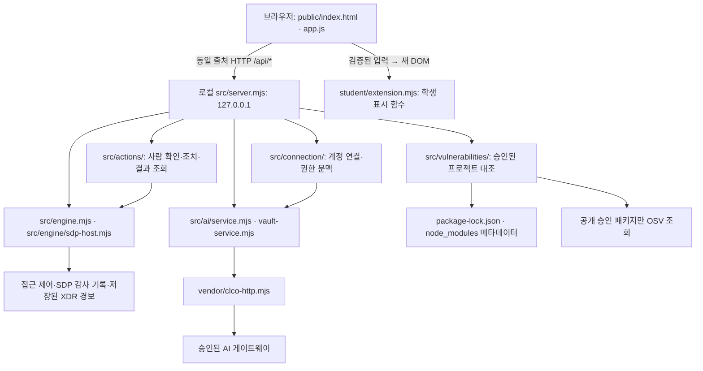

# 크립테아 학생 실행 설명서와 시스템 구성도
## 처음 실행하는 분: 이 순서부터 확인하세요 (2026-10-27 보완)

이 절은 다른 사람이 자기 PC에서 실행할 때 쓰는 안내입니다. 아래쪽의 작성자 이름이 들어간 절대 경로·Node 캐시 경로·과거 측정 수치는 **작성자 PC의 사례와 확인 기록**입니다. 다른 PC에 같은 경로·값이 있다고 가정하지 마세요. 기존 폴더와 제출물은 지우거나 옮길 필요가 없습니다.

### 1) 받은 파일과 실행 위치 확인

받은 프로젝트 안에서 `on-client` 폴더를 엽니다. 그 안에 `package.json`, `student`, `tools`, `src`가 보여야 합니다. 파일 탐색기 주소 표시줄에 `powershell`을 입력하고 Enter를 누르면 **그 폴더**에서 일반 PowerShell이 열립니다. 관리자 창은 필요하지 않습니다.

```powershell
Get-Location
Test-Path -LiteralPath .\package.json
Test-Path -LiteralPath .\student\extension.mjs
Test-Path -LiteralPath .\tools\start-alekov.ps1
Test-Path -LiteralPath .\src\server.mjs
```

네 파일은 모두 True여야 합니다. False가 있으면 다른 폴더에서 열었거나 받은 파일이 빠진 것입니다. 빈 파일을 새로 만들어 맞추거나 기존 코드를 덮어쓰지 말고 폴더와 배포본을 확인하세요. 이미 앱 폴더 자체를 받은 경우, 그 안에서 시작하며 `on-client`를 중복해서 붙이지 않습니다.

PC 상태 추가 기능까지 실행하려면 다음 세 파일도 있어야 합니다.

```powershell
Test-Path -LiteralPath .\student\pc-status-server.mjs
Test-Path -LiteralPath .\student\pc-status.html
Test-Path -LiteralPath .\student\pc-windows-status.ps1
```

**전달 버전 주의:** 2026-10-27 이 보완을 작성한 시점의 HEAD는 `089bfc9d9e2f4e3870be3705e5b19de72dc055d6`이며, PC 상태 추가 파일 3개는 그 커밋에 아직 포함되지 않았습니다. 그 커밋이나 당시 제출 JSON을 받아서는 새 PC 화면을 실행할 수 없습니다. 이는 전달 버전의 차이이며, 파일이 없는 상태를 설정값이나 임의 코드로 보완하지 않습니다. 이후 새 커밋으로 공유받았다면 그 커밋과 위 파일 유무를 다시 확인합니다. 이 문서 수정만으로 Git 업로드가 완료된 것은 아닙니다.

### 2) Node.js 확인

같은 창에서 다음을 실행합니다.

```powershell
node --version
```

- `node`를 찾을 수 없다면 Node.js를 준비한 뒤 PowerShell을 새로 엽니다. 제공 안내의 배포처는 https://nodejs.org 입니다. 이 문서는 설치를 자동 수행하지 않습니다.
- 프로젝트 `package.json`의 수업 기준은 **24.19.0**, 제공 보안 앱 실행 도구의 허용 주 버전은 **22~24**입니다. 이 프로젝트의 최근 실제 검사는 **24.22.1**로 했습니다. 처음 따라 하는 경우 지원되는 Node.js 24.x가 선택됐는지 확인합니다. 다른 모든 버전을 시험했다는 뜻은 아닙니다.
- 작성자 PC의 기본 v20.9.0은 보안 앱 실행 도구의 허용 범위 밖입니다. 다른 사람도 자기 PC의 실제 출력으로 확인해야 합니다.
- 여러 버전이 설치되어 다른 버전이 선택된다면 `Get-Command node -CommandType Application`으로 위치를 확인하고, 본인이 설치한 지원 Node.js를 선택합니다. 아래쪽의 `C:\Users\kimgu\.cache\...` 경로를 다른 사람 PC에 그대로 입력하지 않습니다.

현재 `package.json`에는 외부 npm 의존성이 없습니다. 이 실행을 위해 `npm install`, lock 파일 생성, 임의 패키지 설치·버전 낮추기를 추가하지 않습니다. 설정·토큰·인증 파일을 다른 사람에게 복사해 실행할 필요도 없습니다.

### 3) 원하는 화면에 맞는 명령 실행

둘은 **서로 다른 서버**입니다. 한 명령이 다른 화면까지 켜 주지 않습니다.

| 화면 | 실행할 위치 | 명령 | 브라우저 주소 |
|---|---|---|---|
| 기존 보안 Agent | `package.json`이 있는 앱 폴더 | `powershell -NoProfile -ExecutionPolicy Bypass -File .\tools\start-alekov.ps1` | `http://127.0.0.1:5189/` |
| 추가 「내 PC 상태」 | 같은 앱 폴더, 추가 파일3개 필요 | `node .\student\pc-status-server.mjs` | `http://127.0.0.1:5191/` |

먼저 원하는 명령 한 개를 실행합니다. 정상 시작 신호는 다음과 같습니다. 포트를 바꾸면 출력 주소도 바뀝니다.

- 기존 보안 앱: 실행 도구의 `케셰브가 켜졌습니다. 브라우저에서 http://127.0.0.1:5189/ 을 여세요.`와 `서버가 응답한 것만 확인했습니다.` 안내. 제공 실행 메시지의 기본 이름은 그대로이며 앱 이름은 크립테아입니다.
- PC 상태: `크립테아 내 PC 상태: http://127.0.0.1:5191/`로 시작하는 문장.

명령이 실행 중인 PowerShell 창은 서버가 살아 있는 창입니다. 다음 명령을 입력할 수 있게 돌아오지 않는 것만으로 멈춘 것이 아닙니다. 브라우저에서 해당 주소를 열어 확인하세요. 창을 닫으면 서버도 종료될 수 있습니다.

두 화면을 모두 쓰려면 **PowerShell 창을 두 개** 엽니다. 각각 같은 앱 폴더에서 시작하고, 첫 창에서는 보안 앱 명령, 둘째 창에서는 PC 상태 명령을 실행합니다. 이미 열린 브라우저나 배포 사이트를 보는 것만으로 PC 로컬 서버가 켜지지는 않습니다.

### 4) 브라우저 확인 순서와 결과 읽는 법

1. PC 상태 주소5191을 열면 세 요약과 「조회 전」이 나옵니다. 처음부터 실제 수치가 차 있어야 정상인 것이 아닙니다. 자동 조회하지 않습니다.
2. Tab으로 「PC 자원 다시 조회」로 이동해 Enter를 누릅니다. 약1초 동안 대기 표시 후 CPU(%), 메모리·디스크(GiB), 각각의 실제 시각을 확인합니다. 다시 누르면 기준값과 차이를 비교합니다.
3. 「네트워크·방화벽 다시 조회」 또는 「최근 기록 다시 조회」를 누릅니다. 둘은 네트워크·방화벽·기록을 함께 읽는 한 조회입니다. 최대 약40초가 걸릴 수 있습니다. 조회 중에는 관련 버튼이 비활성화됩니다.
4. 최근 기록의 기간·System/Application별 경고·오류 건수(건)와 조회 시각을 확인합니다. **침해·공격 탐지 결과가 아닙니다.** 읽기 실패는 0건이 아닙니다.
5. SDP 영역은 별도로 읽습니다. 보안 앱이 켜져 있지 않거나 진단 응답을 못 읽으면 「SDP 연결 확인 불가」입니다. 켜져 있어도 엔진이 disconnected이면 「SDP 미연결」입니다. PC 조회 성공과 SDP 성공을 섞지 않습니다. 실제 연결 설정 없이 시작했을 때 미연결이라고 나오는 것이 코드 오류의 증거는 아닙니다.
6. 네트워크 상세·방화벽 상세는 Tab으로 이동한 뒤 Enter로 열고 닫을 수 있습니다. 실패한 항목은 확인 불가·이유·조회 시도 시각·다음 행동을 확인합니다. 권한·방화벽 설정을 바꿔 해결하려 하지 않습니다.

이 문서의 이전 실제 측정값은 그때의 관찰 기록이지 예시를 현재 값으로 넣는 기능이 아닙니다. 다른 PC의 수치와 같을 필요가 없으며 실제 화면에는 이 PC에서 읽은 값만 나옵니다. 모의 검사 결과는 실제 연결·다른 사람 PC 실행 성공으로 계산하지 않습니다.

### 5) 막힌 위치별 확인

| 증상 | 먼저 확인 | 다음 행동 |
|---|---|---|
| 파일·명령 경로를 찾지 못함 | 1장의 현재 위치·파일 유무, 최신 추가 기능을 받은 버전인지 | 올바른 앱 폴더에서 다시 실행. 빠진 파일을 임의로 만들지 않음 |
| `node`를 찾지 못함·지원 버전 아님 | `node --version`, `Get-Command node -CommandType Application` | 자기 PC의 지원 Node.js를 선택하고 새 창에서 재확인 |
| `EADDRINUSE`·포트 사용 중 | 같은 서버가 이미 켜져 있는지 | 켜져 있으면 기존 주소 사용. 다른 앱을 강제 종료하지 말고 아래 대체 포트 사용 |
| `ERR_CONNECTION_REFUSED`·연결 거부 | 명령을 실행한 창이 살아 있는지, 정상 시작 문장·주소·포트가 맞는지 | 해당 서버를 같은 앱 폴더에서 다시 실행하고 브라우저 재조회 |
| PC 수치가 없음 | 「조회 전」인지, 실제 조회 버튼을 눌렀는지 | 직접 조회. 실패면 예시 값 대신 표시된 이유 확인 |
| Windows 항목만 확인 불가 | 일반 Windows PowerShell·지원 명령·읽기 권한·시간 초과 여부 | 일반 권한에서 직접 재시도. 계속되면 담당자 확인. 관리자 실행·정책 변경 금지 |
| SDP 미연결·연결 확인 불가 | 별도 보안 앱5189의 실행과 연결 진단 | PC 조회 결과와 분리. 담당자 설정이 없으면 실제 연결 성공으로 적지 않음 |

다른 프로그램을 유지하면서 포트만 바꾸는 명령입니다. 브라우저 주소도 출력된 번호로 바꿉니다.

```powershell
# 보안 앱: http://127.0.0.1:5190/
powershell -NoProfile -ExecutionPolicy Bypass -File .\tools\start-alekov.ps1 -Port 5190

# PC 상태: http://127.0.0.1:5192/
node .\student\pc-status-server.mjs --port 5192
```

위 두 명령도 둘 다 쓰려면 서로 다른 PowerShell 창에서 실행합니다. PC 상태 화면의 SDP 진단 대상은 현재 코드상 **고정5189**입니다. 보안 앱을5190으로 옮기면 PC 상태 화면에서 SDP를 확인할 수 없다고 나올 수 있으며, 이를 PC 조회 실패로 해석하지 않습니다. 5190을 진단 대상으로 자동 선택하는 기능은 추가하지 않았습니다.

### 6) 종료·재실행·오류 공유

종료하려는 서버를 실행한 창에서 Ctrl+C를 누릅니다. 두 서버를 모두 끄려면 각각의 창에서 종료합니다. 재실행은 같은 앱 폴더에서 같은 명령입니다. 파일·Git 이력을 삭제하거나 reset할 필요는 없습니다. 새로고침하면 브라우저에만 있던 측정 기록은 지워집니다.

계속 막히면 **원인을 추정해 코드를 바꾸기 전에** 다음을 확인합니다.

- 막힌 순서와 실제 실행 명령
- `Get-Location` 결과, 1장의 파일 확인 결과
- `node --version` 결과
- 비밀번호·키·토큰·개인 인증 설정을 제외한 오류 문구 전체

이 보완은 코드와 명령을 대조해 확인한 안내·배포 버전의 혼동을 고친 것입니다. 실제 오류 문구를 아직 받지 못했으므로 상대방의 원인을 확정하거나 다른 PC 재현이 성공했다고 기록하지 않습니다.

---

아래는 기존 구성·상세 안내·시점별 검사 기록입니다. 개인 경로와 과거 결과는 해당 시점의 사례로 읽고, 처음 실행할 때는 위 절차를 먼저 사용합니다.

기준: 2026-10-23, 시작 틀 `alekov-client-starter` 0.2.11, 학생 구현 13~20단계. 이 문서는 21단계의 학생 작성 문서입니다. 직원이 본인의 로그인 사용자·기기·세션, 업무 앱 접근 판정, 최근 보안 기록을 확인하는 앱입니다. AI 설명은 참고 정보이며 조치 실행이나 공식 과제 판정이 아닙니다.

## 1. 준비와 지원 환경

| 항목 | 코드·문서 기준 | 이번에 실제 확인한 값 |
|---|---|---|
| 운영체제 | 제공 실행 도구는 Windows PowerShell용. Native 계정 연결도 Windows 전용 | Windows 환경에서 파일·명령 확인. 다른 OS 실행은 미확인 |
| PowerShell | 제공 도구 `tools/start-alekov.ps1` 실행 | Windows PowerShell 5.1.26100.9711 |
| Node.js | `package.json` engines는 24.19.0, 실행 도구의 허용 주 버전은 22~24 | 기본 `node`는 v20.9.0으로 허용 범위 밖. 별도 런타임은 v24.22.1. 이 두 값은 기준 버전과 다름 |
| Git | 커밋 및 원문 JSON 생성에 필요 | 2.37.2.windows.2 |
| 브라우저 | 로컬 HTTP 페이지를 열 수 있는 PC 브라우저. 메뉴 확인은 1280px 이상 | 이번 문서 작성에서 실제 브라우저 조작은 미확인 |
| 패키지 | 외부 npm 의존성 선언 없음 | 현재 `package-lock.json`과 `node_modules`는 실행 준비 과정에서 생성하지 않음. 실제 설치 버전 대조는 미확인 |

기본 Node.js v20.9.0으로 실행하면 실행 도구가 중단합니다. 먼저 지원 버전이 선택되는 환경을 준비하고 새 PowerShell에서 `node --version`을 확인하세요. 전역 환경이나 설치 프로그램을 이 문서가 자동 변경하지 않습니다. 22~24 전체 버전의 동작을 시험한 것은 아닙니다.

## 2. 위치와 폴더 구조

현재 Git 최상위(커밋·원문 도구 실행 위치):

```text
C:\Users\kimgu\OneDrive\바탕 화면\projects\alekov-starter-0.2.11
```

앱 실행 위치는 그 안의 `on-client`입니다. 다른 PC에서는 본인이 복사한 프로젝트의 실제 경로로 바꿉니다.

```text
alekov-starter-0.2.11/
  on-client/
    README.md
    package.json                 실행 스크립트·시작 틀 버전
    .env.example                 비밀 없는 설정 설명 견본
    tools/start-alekov.ps1       제공 실행 도구
    public/index.html           크립테아 제목과 제공 화면
    public/app.js               제공 UI·조회·취소·입력 검증·학생 DOM 교체
    public/vulnerabilities-view.mjs  제공 패키지 결과 검증·표시
    student/extension.mjs       학생 표시 함수
    student/engine-adapter.mjs  기본 엔진 어댑터
    src/server.mjs             로컬 앱 서버
    src/engine/                SDP 호스트 연결
    src/connection/            계정 연결·호스트 문맥
    src/ai/                    AI 연결·권한·설명 처리
    src/actions/               제공 조치 처리·결과 관리
    src/vulnerabilities/       프로젝트 대조·OSV 조회
    vendor/clco-http.mjs        서버의 AI 게이트 전송 모듈
    api/index.mjs              공개 조회용 Vercel 미리보기 어댑터
    vercel.json                해당 미리보기 배포 설정
    docs/STUDENT_RUNBOOK.md     이 학생 문서
```

`package-lock.json`은 현재 앱 폴더에 없습니다. 실 조회 대상은 운영자가 승인한 프로젝트이며, 학생이 경로나 공개 패키지 허용 목록을 임의로 추가하지 않습니다.

## 3. 시작·정상 신호·중지·재실행

1. 파일 탐색기에서 `on-client`를 열고 주소 표시줄에 `powershell`을 입력합니다. 아래 위치에서도 열 수 있습니다.

```powershell
Set-Location -LiteralPath 'C:\Users\kimgu\OneDrive\바탕 화면\projects\alekov-starter-0.2.11\on-client'
node --version
```

이 PC에서 확인한 별도 런타임을 사용하려면, 위에서 새로 연 창에 한해 다음을 실행할 수 있습니다. 경로가 다른 PC에 있다고 가정하지 않습니다. 창을 닫으면 이 창의 PATH 변경은 끝나며 전역 설정은 바뀌지 않습니다.

```powershell
$kripteaNodeDirectory = 'C:\Users\kimgu\.cache\codex-runtimes\codex-primary-runtime\dependencies\node\bin'
$env:Path = $kripteaNodeDirectory + ';' + $env:Path
node --version
```

이번 확인 값은 v24.22.1이며 수업 기준 v24.19.0과 다릅니다. 다른 PC에서는 본인에게 설치된 지원 Node.js 경로를 사용합니다.

2. 지원 Node.js가 선택된 것을 확인하고 제공 실행 도구를 실행합니다. 외부 npm 의존성이 없어 현재 프로젝트의 기본 실행에 `npm install`을 추가하지 않습니다.

```powershell
powershell -NoProfile -ExecutionPolicy Bypass -File .\tools\start-alekov.ps1
```

3. 브라우저에서 `http://127.0.0.1:5189/`를 엽니다. 실행 도구가 HTTP 200을 확인하면 다음 문장을 출력합니다.

```text
케셰브가 켜졌습니다. 브라우저에서 http://127.0.0.1:5189/ 을 여세요.
서버가 응답한 것만 확인했습니다. AI 연결 상태는 화면에서 따로 확인해 주세요.
```

실행 도구의 기본 이름 메시지는 제공 원문 그대로입니다. 앱 이름은 **크립테아**이며 이 메시지에 맞춰 이름을 되돌리지 않습니다. 서버 시작 신호는 계정·SDP·AI 연결 성공을 뜻하지 않습니다. 브라우저에서는 크립테아 제목과 보호 현황·업무 앱·보안 기록 메뉴를 확인합니다. 기본 실행은 외부 시스템 미연결입니다.

4. 기본 포트가 사용 중이면 기존 프로그램을 종료하지 말고 다음처럼 다른 포트를 사용합니다. 브라우저 주소도 `http://127.0.0.1:5190/`으로 바꿉니다.

```powershell
powershell -NoProfile -ExecutionPolicy Bypass -File .\tools\start-alekov.ps1 -Port 5190
```

5. 일반 실행은 실행한 창에서 Ctrl+C로 중지합니다. 해당 주소가 응답하지 않는지 확인합니다. 재실행은 같은 폴더에서 같은 시작 명령을 사용합니다. 기본 포트의 시작·Ctrl+C·재실행을 이번 문서 작성에서 직접 시험한 것으로 기록하지 않습니다.

선택 사항: `-Background`로 실행하면 도구가 출력한 프로세스 번호의 node를 작업 관리자에서 종료합니다. 다른 node나 다른 프로젝트를 종료하지 않습니다. `-Demo`는 예제 자료이며 실제 연결을 인증하지 않습니다. `npm start`는 `node src/server.mjs`, `npm run demo`는 같은 서버의 `--demo`, `npm run check`는 학생 파일 문법 검사입니다. 직접 npm 실행에는 제공 도구의 사전 검사·환경변수 제거가 적용되지 않습니다.

## 4. 설정 경계

기본 실행에는 키 입력이 필요하지 않습니다. `.env.example`은 설정 견본이며 복사만으로 연결되지 않습니다. 실행 도구는 비밀로 보이는 환경변수와 `ON_AI_` 환경변수를 자식 서버에 넘기지 않습니다. 서버가 `.env`를 자동 읽는다고 가정하거나 실행 도구의 보호 필터를 제거하지 않습니다.

실제 연결은 담당자가 발급·안내한 별도 `-NativeHostConfig`(계정·AI 호스트), `-SdpHostConfig`(접근 제어·보안 기록 호스트)가 필요합니다. 실행 도구의 해당 옵션이 각각 서버의 `--native-host-config`, `--sdp-host-config`로 전달됩니다. 설정 파일은 프로젝트·Git·JSON 밖에 보관하고 내용·키·토큰·비밀번호를 문서나 채팅에 넣지 않습니다. 담당자에게 실제 파일 경로를 안내받기 전에는 추측한 경로로 실행하지 않습니다. `-Demo`와 SDP 설정은 함께 쓸 수 없습니다. 자세한 제공 계약은 [SDP_HOST_CONNECTION.md](SDP_HOST_CONNECTION.md), [AI_SETUP_GUIDE.md](AI_SETUP_GUIDE.md)를 참조합니다.

## 5. 글로 쓴 시스템 구성도



이 그림은 구현된 경로의 관계이며 실제 외부 연결 성공 기록이 아닙니다. 브라우저는 앱 서버에 요청하고 서버가 계정·권한·입력·결과를 검증합니다. 학생 함수는 전달된 입력을 표시하며 직접 게이트웨이·OSV·조치 서버를 호출하지 않습니다. XDR은 저장된 경보를 조회하며 브라우저에서 새로 탐지하지 않습니다. OSV 공개 조회 출처는 `https://api.osv.dev/v1/querybatch`입니다. 비공개 패키지 이름은 외부로 보내지 않습니다.

SDP 대상·실제 게이트 주소·자격은 이 문서에 적지 않습니다. 위 SDP·AI·조치 화살표는 정식 설정과 권한이 준비되어야 동작하며 실제 학생 계정 조치 집행은 미완료·미확인(UNV)입니다. AI 모델 목록 점검은 사건 설명 실행이 아닙니다. 수업용 코딩 AI, 앱 내부 설명 AI, ALEPH 공식 과제 판정 AI는 역할이 다릅니다.

공개 주소 `https://alekov-starter-0-2-11.vercel.app/`는 `api/index.mjs`와 `vercel.json`의 조회용 미리보기입니다. 허용된 GET만 전달하며 POST는 `405 PREVIEW_READ_ONLY`입니다. 로컬 계정 연결·유료 AI 설명·조치 집행을 이 미리보기에서 확인했다고 쓰지 않습니다. 현재 로컬 커밋과 배포 사이트 버전의 일치는 이번 단계에서 확인하지 않았습니다.

## 6. 학생 작성과 제공 코드, 검증 범위

| 단계·학생 함수 | 학생이 작성한 표시 | 확인 수준·남은 확인 |
|---|---|---|
| 13 `renderIdentity` | 계정·기기·세션, 상태 한국어와 원래 값 | 과거 코드·모의 검사. 현재 실제 계정 조회 미확인 |
| 14 `renderDecision` | 허용·거부·추가 확인·확인 불가·요청 실패, 이유·시각 | 과거 코드·모의 검사. 실제 앱 접속 성공을 보장하지 않음 |
| 15 `renderEvents` | 최근 본인 기록의 필터·정렬·근거·규칙·세 상태 | 과거 코드·모의 검사. 전체 직원·전체 이력·실시간 탐지 아님 |
| 16 `renderStatus` 및 기록 상세 | 알림·빈 목록·오류·안전 필드 복사, 미지원 비활성 안내 | 과거 모의 검사. 실제 클립보드·실제 조치 미확인 |
| 17 `renderAiConnection` | 연결 점검·권한·한도·취소와 수동 복구 안내 | 제출 피드백 8개 통과·실제 모델 호출 항목 확인 불가. 공식 전체 통과로 단정하지 않음 |
| 18 `renderExplanation` | 현재 근거와 연결된 참고 요약·규칙·unknown·미실행 제안 | 모의 DOM·코드 대조 133개 통과. 실제 유료 설명 미실행 |
| 19 `renderAction` | 준비·전송·ACK·효과 관측·결과 불명 구분 | 모의 DOM·코드 대조 1,011개 통과. 실제 집행·효과 재조회는 UNV |
| 20 `renderVulnerabilities` | 정확한 전달 버전·출처·시각·부분 결과·미조회 구분 | 모의 DOM·제공 검증기 147개 통과. 실제 OSV 조회·설치 버전 대조 미확인 |

제공 부분은 `public/app.js`의 메뉴·조회·취소·세대 검사·입력 검증·DOM 교체, `src/`의 서버·연결・AI·조치·OSV 처리, 실행 도구입니다. 이를 학생 구현 성취로 대신 계산하지 않습니다. 학생 함수는 `document.createElement`·`textContent`로 DOM을 반환하며 서버·인증·정책을 변경하지 않습니다. 화면 이름은 `public/index.html`에 크립테아로 반영되어 있으나 제공 실행 메시지·실행 파일명은 그대로입니다. 이번 21단계는 학생 문서와 README 안내만 변경합니다.

기기 보안 상태는 악성코드 검사·치료가 아닙니다. allow는 정책 판정이며 실제 앱 접속 보장이 아닙니다. AI 제안은 사람 확인·서버 요청·효과 관측과 다릅니다. ACK·unknown은 효과 확인이 아니며 취소는 이미 집행된 효과를 되돌리지 않습니다. OSV의 none_found는 조회 범위에 알려진 항목이 없다는 뜻입니다.

## 7. 오류별 확인·복구 순서

| 증상·코드 | 먼저 확인 | 복구·다음 확인 |
|---|---|---|
| Node.js 없음·지원 버전 아님 | 새 창의 `node --version` | 지원 버전을 준비하고 동일 명령 재실행. 현재 기본 v20.9.0은 사용하지 않음 |
| 앱 폴더 아님·실행 파일 없음 | 현재 위치와 `tools/start-alekov.ps1`, `src/server.mjs`, `package.json` | 파일을 덮어쓰지 말고 올바른 on-client에서 실행 |
| 포트 사용 중·시작 시간 초과 | 실행 도구 메시지, 선택 포트 | 다른 프로그램은 보존하고 `-Port 5190` 사용. 시간 초과는 비밀을 제외한 오류와 함께 담당자 확인 |
| `ENGINE_NOT_CONNECTED`·조회 실패 | 기본 미연결인지, 담당자 설정 준비 여부 | 제공 「다시 불러오기」로 직접 재시도. 성공 전까지 빈 결과·정상으로 처리하지 않음 |
| `NATIVE_HOST_DISABLED`·`ON_AI_PROVISIONING_PENDING` | 계정 연결·앱 권한·호스트 설정 준비 여부 | 담당자 확인. 열쇠 복사·임의 모델·대체 연결 추가하지 않음 |
| AI 인증·한도·시간 초과·취소 | 학생 연결 영역의 안전한 코드와 안내 | 인증·한도는 담당자 확인, 일시 오류는 제공 「AI 연결 점검」으로 수동 재시도. 모델 목록만으로 설명 성공 처리하지 않음 |
| `ON_AI_INVALID_INPUT`·`ON_AI_INVALID_OUTPUT` | 현재 기록의 근거·규칙과 설명 상태 | 설명을 사용하지 않고 기록 유지. 없는 근거를 만들어 맞추지 않음 |
| 조치 `pending`·`unknown`·`ACTION_TIMEOUT` | requestId·receiptId·version·관측 여부 | 제공 「원천 결과만 재조회」 사용. 다시 집행하거나 효과 없음으로 단정하지 않음 |
| `ACTION_CONFIRMATION_EXPIRED` | 대상과 확인 기한 | 제공 화면에서 다시 준비. 학생 코드에 티켓이나 집행 버튼 추가하지 않음 |
| 패키지 not_configured·not_checked | 대상 설정·공개 승인 목록 준비 여부 | 정상적인 미조회 가능. 담당자 확인, 임의 허용 목록·경로 변경 금지 |
| 패키지 partial·unverifiable·error | 현재 해시·시각·확인된 취약점 ID | 일부 ID 보존, 취약점 없음으로 해석하지 않음. 제공 「설치 패키지 조회」로 직접 재시도 |
| Vercel 405·미지원 주소 | 조회용 미리보기의 요청 제한 | 로컬 앱과 구분. 제한을 임의 해제하지 않음 |

보호 현황의 「도움정보 불러오기」는 제공 영역입니다. 학생 상태 영역의 「도움정보 복사」는 requestId·component·version·checkedAt·engine.mode·engine.code만 복사합니다. 내용은 보내기 전에 직접 확인하고 비밀번호·키·토큰은 포함하지 않습니다. 오류를 고치기 위해 기존 작업·Git 기록을 삭제하거나 origin을 바꾸지 않습니다.

## 8. 실제 확인과 미확인 기록

2026-10-23 실제 실행 검사: 이 PC의 별도 Node.js v24.22.1을 검사 프로세스의 PATH에만 선택하고, on-client에서 제공 도구를 `-Background -Port 5197`로 실행했습니다. 두 차례 시작 → HTTP 200 및 크립테아 제목 확인 → 이번에 시작한 프로젝트 서버 프로세스만 종료 순서로 재실행을 확인했습니다. 종료 후 해당 포트의 리스너가 없는 것도 확인했습니다. 별도 진단 응답은 engine.mode=disconnected, ai.configured=false였습니다. 기존 작업·포트 5189·전역 PATH·연결 설정은 변경하지 않았습니다.

자동 검사 중 Windows가 자식 서버 종료까지 기다리는 출력 수집 방식 때문에 지연이 있었습니다. 검사 방식에서 실행 도구 프로세스만 기다리도록 조정한 뒤 위 두 차례 검사를 통과했습니다. 앱 코드나 실행 도구를 수정해서 해결한 문제가 아닙니다. 표준 실행의 Ctrl+C와 실제 브라우저 조작은 이 검사로 인증하지 않습니다.

실행 도구 검사 결과는 이 문서 작성 중 얻은 실제 출력만 기재합니다. 기본 미연결에서 진단 응답을 받는 것은 실제 AI·SDP 연결 성공과 다릅니다. 브라우저를 통한 메뉴 이동·사람 확인·클립보드·유료 설명·실제 집행·OSV 조회·새 PC 재현은 이번 단계에서 미확인입니다. 과거 모의 검사 수는 해당 단계의 시점 기록이며 공식 통과 인증이 아닙니다.

직접 확인은 한 번에 하나씩 진행합니다. 먼저 기존 작업을 보존한 새 PowerShell 창에서 3장의 실행 절차를 따라 하고 정상 시작 신호를 확인합니다. 그 결과를 확인한 다음 브라우저의 메뉴·버튼·학생 표시와 제공 결과를 대조합니다. 계정이나 정책을 바꿔 오류·유료 요청·조치를 억지로 재현하지 않습니다.

## 9. 21단계 커밋·원문 제출

제공 실행 안내에는 21·22단계 방식이 미정이라고 남아 있으나, 이번 공식 안내에 따라 두 단계는 서버 AI가 문서·구성도·실행 파일·설정 견본을 원문으로 대조합니다. 서버가 명령을 실행하여 재현을 인증하는 방식이 아닙니다. 이번 안내에서는 워크벤치 제출 준비가 13~20단계를 지원하므로 21단계는 과제 화면에 저장소 주소와 실제 40자리 커밋을 직접 입력합니다. 비공개 저장소를 공개로 바꿀 필요가 없습니다.

커밋·도구 실행 위치는 2장의 Git 최상위입니다. 이미 준비된 다른 변경이 있으면 먼저 목록을 확인하고 보존합니다. 실제 변경 학생 문서와 README 학생 안내를 같은 커밋에 담고, 기존 학생 코드도 그 커밋의 누적 트리에 포함되는지 확인합니다. 이번 단계에는 앱 코드 수정이 없습니다. 강제 push·reset·삭제·origin 변경을 하지 않습니다.

원문 도구는 기존에 프로젝트 밖에 풀어 둔 다음 파일을 사용합니다.

```text
C:\Users\kimgu\OneDrive\바탕 화면\projects\크립테아-제출자료\도구\alekov-source-tool\student-source-cli.mjs
```

새 출력 파일 경로와 실제 커밋을 확인한 뒤 프로젝트 최상위 PowerShell에서 실행합니다. 아래 변수의 안내 문구를 그대로 실행하지 말고 실제 값을 지정합니다.

```powershell
$submissionCommit = Read-Host '제출할 실제 40자리 커밋 번호'
$submissionOutput = Read-Host '프로젝트 밖에 저장할 아직 없는 JSON의 절대 파일 경로'
node 'C:\Users\kimgu\OneDrive\바탕 화면\projects\크립테아-제출자료\도구\alekov-source-tool\student-source-cli.mjs' --commit $submissionCommit --output $submissionOutput
```

도구는 기존 출력 폴더가 필요하며 파일을 덮어쓰지 않습니다. 예를 들어 기존 `크립테아-제출자료` 폴더 안의 아직 없는 JSON 이름을 선택합니다. 앞서 확인한 지원 Node.js로 실행합니다. 현재 기본 v20.9.0을 무조건 사용하라는 뜻이 아닙니다. 도구는 커밋된 원문만 묶고 학생 코드를 실행하거나 업로드하지 않습니다. 미커밋 작업은 포함되지 않습니다.

실제 저장소 주소는 프로젝트 최상위에서 읽기 전용으로 `git remote get-url origin`, 커밋 번호는 `git rev-parse HEAD`로 확인할 수 있습니다. 이 결과와 JSON의 커밋이 일치해야 합니다. 생성 JSON을 같은 단계의 「비공개 저장소 원문 묶음」에서 선택한 뒤 저장소·커밋·단계를 다시 확인하여 직접 제출합니다. 접수·원문 수신·공식 통과는 별개입니다. 원문 전달만 실패하면 접수를 유지하고 「원문만 다시 보내기」를 사용합니다. 키·비밀번호·토큰·개인 설정 파일을 원문 묶음에 넣지 않습니다.

## 10. 승인 후 추가한 학생용 「내 PC 상태」(2026-10-26)

이 절은 22단계 제출 커밋 이후 사용자가 승인한 추가 작업입니다. 기존 제출물과 원문 JSON을 교체하지 않았으며, 기존 보안 앱의 제공 코드·실행 도구·인증 설정은 변경하지 않았습니다.

| 구분 | 구현 범위 |
|---|---|
| 제공 시작 틀 | 등록 기기의 ID·이름·보안 기준 상태, 업무 앱 판정, 보안 기록. CPU·메모리·디스크 자원 측정은 없음 |
| 학생 추가 `student/pc-status-server.mjs` | Node.js OS 읽기, 로컬 화면과 조회 API. 외부 패키지·관리자 권한·외부 전송·기록 파일 저장 없음 |
| 학생 추가 `student/pc-status.html` | 실제 측정값·시각·단위·실패 이유, 사용자가 누른 두 시점 비교. 브라우저 메모리에만 기준값 보관 |

### 실행과 종료

기존 보안 앱은 `http://127.0.0.1:5189/`, 추가 화면은 `http://127.0.0.1:5191/`입니다. 두 서버는 별개입니다. 기존 화면에 새 메뉴를 끼워 넣거나 기존 보안 앱의 `/api/diagnostics` 계약을 바꾸지 않았습니다. Vercel 미리보기에 이 PC 측정 기능을 배포하지 않습니다. 측정 대상은 로컬 서버를 실행한 PC이며 원격 접속한 브라우저의 PC를 측정하는 기능이 아닙니다.

일반 PowerShell에서 `on-client`로 이동합니다. 이 PC에서 실제 확인한 Node.js 경로를 쓰는 명령은 다음과 같습니다. 다른 PC에서는 지원 Node.js가 설치된 실제 경로로 바꿉니다.

```powershell
Set-Location -LiteralPath 'C:\Users\kimgu\OneDrive\바탕 화면\projects\alekov-starter-0.2.11\on-client'
$kripteaNode = 'C:\Users\kimgu\.cache\codex-runtimes\codex-primary-runtime\dependencies\node\bin\node.exe'
& $kripteaNode --version
& $kripteaNode .\student\pc-status-server.mjs
```

`크립테아 내 PC 상태: http://127.0.0.1:5191/` 시작 문장을 확인한 뒤 주소를 브라우저로 엽니다. 종료는 이 명령을 실행한 창에서 Ctrl+C, 재실행은 같은 명령입니다. 이미 실행 중인 경우 새 서버를 중복 실행하지 말고 기존 주소를 엽니다. 포트가 사용 중이면 다른 프로그램을 종료하지 않고 `--port 5192`를 붙여 실행하며 주소도 5192로 바꿉니다. 바인딩은 127.0.0.1로 제한됩니다. 일반 사용자 토큰으로 실행하며 관리자 PowerShell을 열 필요가 없습니다.

### 표시와 비교 기준

- 화면을 열기만 해서는 측정하지 않습니다. 「처음 측정」은 기준값을 새로 만들며 「다시 측정하여 비교」는 그 기준과 비교합니다. 반복 클릭 중에는 버튼을 비활성화하고 서버도 동시 측정을 차단합니다.
- CPU는 약 1초 동안 전체 논리 CPU 평균 사용률(%). 각 측정의 실제 구간(ms)과 종료 시각을 붙입니다. 브라우저나 Node.js 프로세스 하나의 사용률이 아닙니다.
- 메모리는 OS의 전체 물리 메모리에서 남은 물리 메모리를 뺀 사용량(GiB), 전체량(GiB)과 사용 비율(%)입니다. 작업 관리자와 분류 기준이 다를 수 있습니다.
- 디스크는 프로젝트가 들어 있는 볼륨의 사용 가능한 공간(GiB)이며 모든 드라이브의 합계가 아닙니다. 1 GiB는 1,073,741,824바이트입니다.
- 각 값의 시각을 KST와 UTC 원문으로 함께 표시합니다. 비교는 CPU의 퍼센트포인트(%p), 메모리·공간의 GiB 차이와 각 항목의 측정 간격(초)을 표시합니다. 반올림 전 값으로 차이를 계산하므로 보이는 숫자를 뺀 값과 끝자리가 다를 수 있습니다.
- 읽기 실패는 「확인 불가」·일반 권한/지원 API/유효 값 부족 등의 이유·조회 시도 시각·기대 단위를 표시합니다. 한 항목의 실패가 다른 항목의 읽기를 막지 않습니다. 실패값은 0·예시·과거 정상값으로 채우지 않습니다.
- 요청 중에는 이전 표를 현재 값처럼 남기지 않습니다. 기준값은 별도 「처음 측정·기준값」 영역에만 유지합니다. 서버 전체 응답 실패 시 이번 결과와 비교를 확인 불가로 바꿉니다.
- 새로고침·탭 종료 시 측정 이력은 사라집니다. 자동 수집·자동 재시도·영구 저장·예시 자료 생성은 없습니다. 두 시점 차이를 장기 추이·보안 경보·이상 판정으로 표현하지 않습니다.

### 실제 검사와 모의 검사의 구분

2026-10-26, 동일 PC의 Windows 일반 사용자 토큰(관리자 아님), Node.js v24.22.1에서 확인했습니다.

| 항목 | 처음 실제 측정 | 다시 실제 측정 | 화면의 차이 |
|---|---|---|---|
| CPU | 10:05:40.839 KST, 77.93%, 구간1018ms | 10:05:55.294 KST, 64.65%, 구간1008ms | -13.28 %p, 간격14.5초 |
| 메모리 | 10:05:40.839 KST, 7.39/7.79 GiB, 94.77% | 10:05:55.294 KST, 7.41/7.79 GiB, 95.08% | +0.02 GiB |
| 디스크 | 10:05:40.842 KST, 98.18 GiB | 10:05:55.294 KST, 98.17 GiB | -0.01 GiB |

이 표는 해당 시각의 실제 관찰 기록이며 현재 값을 고정한 예시가 아닙니다. 화면에 이 표의 숫자를 하드코딩하지 않았습니다. 이후 다시 측정하면 달라집니다.

읽기 권한 거부·API 미지원·유효하지 않은 값·응답 실패·실패 후 기준 초기화 등은 실제 OS 장애를 만들지 않고 별도 모의 검사 111개로 확인했습니다. 로컬 HTTP의 출처·호스트·지원 경로·GET 제한·동시 요청 차단은 모의 측정기를 쓴 검사 13개로 확인했습니다. 모의 값은 실제 화면에 전달하지 않았습니다. 실제 브라우저 두 측정·비교에서 수집된 error 로그는 없었습니다.

### 같은 결과를 다시 확인하는 순서

1. 원래 보안 앱과 제출 파일을 보존하고 위 명령으로 별도 학생 화면을 엽니다.
2. 최초에는 「측정 전」이고 비교 버튼이 비활성인지 확인합니다.
3. 「처음 측정」을 누르고 약 1초 뒤 세 값의 실제 단위·시각·출처 표시를 읽습니다.
4. 잠시 뒤 「다시 측정하여 비교」를 누르고 기준값·이번 값·변화량·간격을 대조합니다. 수치 자체는 위 기록과 같을 필요가 없습니다.
5. 새로고침하면 기록이 지워지는지 확인합니다. 정상 측정의 실패를 재현하려고 시스템 권한이나 설정을 변경하지 않습니다.
6. 서버를 끈 뒤 이미 열린 화면에서 다시 측정하면 「확인 불가」와 이유·조회 시도 시각이 나오는지 확인할 수 있습니다. 이 작업은 측정 서버만 중지하며 원래 보안 앱을 중지할 필요가 없습니다.
실제 오류·복구 확인: 2026-10-26 10:09:42 KST에 이번 측정 서버만 중지한 상태에서 버튼을 눌러, 현재 값·기준값·비교가 확인 불가와 이유·조회 시도 시각으로 표시되는 것을 확인했습니다. 기존 보안 앱은 유지했습니다. 이후 동일 일반 사용자 권한으로 서버를 재시작하고 버튼을 직접 눌러 복구를 확인했습니다. 이 의도적인 서버 중지 때의 접속 실패 로그는 예상한 오류이며, 성공 측정 때의 오류 로그 검사와 구분합니다.

## 11. 네트워크·방화벽 기본 정책·최근 Windows 기록 (2026-10-27 승인 추가)

기존 5191 학생 PC 상태 화면에 「PC 구성·최근 기록 조회」를 추가했습니다. 5189 보안 앱이나 이미 낸 제출물은 변경하지 않습니다. 파일 범위는 `student/pc-windows-status.ps1` 추가, `student/pc-status-server.mjs`·`student/pc-status.html`·이 문서 수정입니다. CPU·메모리·디스크의 기존 측정과 두 시점 비교는 유지합니다.

### 제공 부분과 학생 추가 부분

- 제공 시작 틀: 기기 보안 기준 상태와 보안 앱의 연결 진단. 일반 PC 구성·이벤트 로그 통계와는 별개입니다.
- 학생 추가: 읽기 전용 PowerShell 결과를 새 로컬 GET `/api/windows-status`로 전달하고 표시합니다. 브라우저를 열기만 해서는 조회하지 않으며 사용자가 버튼을 누를 때만 실행합니다.
- SDP: 서버가 고정된 로컬 주소 `http://127.0.0.1:5189/api/diagnostics`만 읽습니다. 진단이 disconnected이면 「SDP 미연결」, 응답 실패·입증할 수 없는 다른 모드이면 「SDP 연결 확인 불가」입니다. PC 조회 성공·인터페이스 존재·인터넷 접속만으로 실제 SDP 연결을 표시하지 않습니다. 실제 SDP 서버를 새로 연결하거나 자격을 발급하는 기능이 아닙니다.

### 조회 범위·읽기 권한·한계

| 표시 | 읽는 방법 | 시각·단위·한계 |
|---|---|---|
| 네트워크 | `Get-NetIPConfiguration`의 인터페이스 이름·IPv4/IPv6·기본 게이트웨이·DNS | 조회 시각(KST·UTC), 인터페이스 수(개), 주소 값. 빈 주소는 「조회된 구성값 없음」. 연결 품질·외부 도달성 시험 안 함 |
| 방화벽 | `Get-NetFirewallProfile -PolicyStore ActiveStore` | 각 프로필 활성 여부·기본 인바운드/아웃바운드 원래 코드와 한국어·조회 시각. 개별 규칙·실제 차단 효과·활성 네트워크와의 매핑 판정 아님 |
| 최근 기록 | `Get-WinEvent`로 System·Application, Warning(3)·Error(2), 조회 시점까지 최근24시간 | 로그별 경고·오류 건수(건), 시작·종료 시각·조회 시각. Critical(1)·Security 로그·원문 메시지·공급자별 분석 제외 |
| SDP | 기존 보안 앱의 엔진 진단 | 별도 영역·별도 확인 시각. PC 조회와 독립적이며 실연결 인증 범위를 넓히지 않음 |

**경고·오류 건수는 침해나 공격 탐지 결과가 아닙니다.** Windows가 기록한 해당 수준의 건수이며, 많거나 적다는 이유만으로 공격·정상·안전을 판정하지 않습니다. 악성 행위를 만들거나 공격·침투를 흉내 내는 시험은 하지 않았습니다.

모든 Windows 명령은 일반 사용자 토큰으로 실행합니다. 관리자로 실행된 조회 helper는 읽기를 거부하고 확인 불가로 반환합니다. 권한 거부·명령/서비스 사용 불가·시간 초과는 확인 불가와 안전한 이유·조회 시도 시각을 표시합니다. 설정 변경, 방화벽 규칙 추가·비활성화, 보안 설정·권한·ACL 변경, 관리자 실행 요청은 없습니다. 항목별 실패를 0건이나 예시로 채우지 않으며, 0건은 지정 범위에 일치하는 기록이 없음을 정상 조회로 확인한 경우에만 표시합니다.

네트워크 주소·기록 건수는 로컬 화면의 실제 조회값이며 외부 전송·파일 저장·예시 생성·자동 재조회는 없습니다. 재조회 중에는 이전 PC 구성과 SDP 표시를 지우고 현재 결과 미확인으로 표시합니다. Windows helper는 최대40초, SDP 진단은 최대3초이며 서로 독립적으로 조회합니다. Windows 응답 실패가 SDP 연결을 의미하거나 반대가 되지 않습니다.

### 실제 확인 기록과 모의 검사

2026-10-27 실제 일반 사용자 토큰(관리자 아님), Node.js v24.22.1, Windows PowerShell에서 확인했습니다. 실제 화면의 한 조회 기록은 네트워크 3개(15:36:48 KST), Domain·Private·Public 모두 활성·기본 인바운드 Block·아웃바운드 Allow(15:36:50), System 경고1846건·오류19건, Application 경고2건·오류9건(15:36:53)입니다. 기록 범위는 2026-10-26 15:36:50~2026-10-27 15:36:50 KST입니다. 별도 SDP 진단은 15:36:41에 disconnected여서 「SDP 미연결」로 보였습니다. 이 숫자는 그 시각 실제 관찰 기록이며 화면에 하드코딩하지 않았습니다. 이후 조회할 때 범위와 수치는 바뀝니다.

실제 검토 중 빈 게이트웨이가 쉼표로만 나타나는 문제를 찾아 빈 항목을 제거하도록 수정했습니다. 읽지 못한 값이 아니라, OS가 반환한 빈 구성값을 구분하는 처리입니다. 원문 메시지나 토큰은 화면에 쓰지 않습니다.

기존 PC 측정 모의111개를 포함한 누적 모의191개에서 권한 거부·관리자 컨텍스트 거부·미지원 환경·잘못된 응답·시간 초과·정상0건·항목별 실패·SDP 장애 분리·이전 결과 제거를 확인했습니다. 별도 HTTP 모의15개는 요청 방식·출처·호스트 제한·동시 조회 차단·SDP 실패 분리를 확인했습니다. 모의 IP·건수는 격리된 검사에서만 썼으며 실제 화면 데이터와 섞지 않았습니다. PowerShell 구문 트리에서 Get 계열·필터·JSON 변환 및 자체 helper 외의 실행 명령이 없는 것도 대조했습니다.

### 같은 결과 재현하기

1. 일반 PowerShell에서 기존 앱 폴더 `on-client`를 엽니다. 관리자 창은 사용하지 않습니다.
2. 10장의 지원 Node.js 명령으로 `node student/pc-status-server.mjs`를 실행하고 `http://127.0.0.1:5191/`를 엽니다. 이미 실행 중이면 새 프로세스를 중복 실행하지 말고 브라우저만 새로고침합니다. 이번 수정 전에 켜 둔 PC 상태 서버는 종료 후 다시 실행해야 합니다. 5189 보안 앱을 중지할 필요는 없습니다.
3. 「PC 구성·최근 기록 조회」를 한 번 누릅니다. 약40초 이내에 네트워크·방화벽·로그별 결과와 각 시각을 확인합니다. 값과 건수가 위 기록과 같을 필요는 없습니다.
4. 「침해나 공격 탐지 결과가 아닙니다」 문구와 「SDP 연결 상태·PC 조회와 별개」 영역을 확인합니다. 현재 미연결이면 「SDP 미연결」, 진단을 읽을 수 없으면 연결 확인 불가가 맞습니다.
5. 다시 조회하면 이전 값이 조회 중 표시로 바뀌고 새 시간 범위·결과로 교체되는지 확인합니다. 실제 방화벽·권한·보안 설정을 바꿔 실패를 만들지 않습니다.
6. 종료는 실행한 PowerShell에서 Ctrl+C, 재실행은 같은 명령입니다.

필요하면 같은 앱 폴더의 일반 PowerShell에서 아래 **읽기 전용** helper를 직접 실행해 JSON과 화면을 대조할 수 있습니다. 네트워크 주소가 포함되므로 원문을 외부에 올리거나 제출 자료에 자동 포함하지 않습니다.

```powershell
powershell -NoProfile -NonInteractive -ExecutionPolicy Bypass -File .\student\pc-windows-status.ps1
```

`-ExecutionPolicy Bypass`는 이 한 번의 프로세스에만 적용되며 시스템 실행 정책이나 Windows 보안 설정을 변경하지 않습니다. 원래 22단계 커밋·제출 JSON은 그대로 두었으며 이번 추가 기능은 아직 커밋·push·배포·제출하지 않았습니다.
## 12. 학생 영역과 핵심 기능 화면 정리 (2026-10-27 승인 추가)

이번 작업의 수정 범위는 `student/extension.mjs`, `student/pc-status.html`, 이 문서 세 파일입니다. 이전에 추가한 조회 서버·Windows helper는 유지했습니다. 제공 `public/index.html`·`public/app.js`·`public/style.css`, 제공 서버·실행 도구·인증 설정·기존 제출물은 수정하지 않았습니다.

### 학생 영역과 설치형 적용 경계

현재 시작 틀 0.2.11은 `student/extension.mjs`의 `createStudentView`에서 받은 DOM을 학생 칸에 표시합니다. 이 반환 DOM 내부에만 간격·테두리·대비·그룹 이름·조회 중 aria-busy를 적용했습니다. 보호 현황·업무 앱·보안 기록의 학생 영역은 각각 핵심1 계정·기기, 핵심2 판정·이유, 핵심3 기록·근거 안내를 앞에 표시합니다. 기존 입력·상태 코드·원래 값·필수 data-* 속성·필터·상세 보기는 유지합니다. 기존 반환 DOM만 꾸미며 공통 화면 순서나 제공 메뉴를 재배치하지 않습니다.

현재 프로젝트에는 `student/appearance.json`과 이를 읽는 계약·로더가 없습니다. 형식을 추측해 만들지 않았습니다. 설치형 앱에서도 이 학생 DOM 계약을 지원하는지 실제 설치형 실행은 미확인이며, 공통 파일 수정이나 별도5191 화면이 자동 반영된다고 주장하지 않습니다. 웹 로컬5189에서 학생 영역의 반영은 확인했습니다.

### 별도5191 화면의 핵심3개

1. **PC 자원과 두 시점 비교:** 실제 CPU·메모리·디스크 값과 시각을 위쪽에 요약합니다. 「PC 자원 다시 조회」는 기준이 없으면 처음 측정, 기준이 있으면 그 기준과 비교합니다. 기존 「처음 측정」은 기준을 새로 만듭니다.
2. **네트워크·방화벽:** 인터페이스 수와 방화벽 프로필 활성·비활성·확인 불가 수, 각 조회 시각을 요약합니다. 상세 주소와 프로필 기본 설정은 키보드로 열 수 있는 펼침 영역에 둡니다.
3. **최근 Windows 경고·오류:** 로그별 실제 건수·기간·시각을 요약합니다. 건수는 공격 탐지 결과가 아니며 읽기 실패를0건으로 대신하지 않습니다.

SDP는 별도 요약·별도 상세로 유지합니다. PC 성공이 SDP 성공이 되지 않습니다. 넓은 화면은3열, 좁은 화면은 세 요약을 세로로 표시하며 상세보다 먼저 배치합니다.

| 버튼 | 실제 조회 범위 |
|---|---|
| PC 자원 다시 조회 | CPU·메모리·프로젝트 볼륨의 남은 공간 |
| 네트워크·방화벽 다시 조회 | 기존 Windows 조회1회. 네트워크·방화벽·최근 기록·SDP를 함께 갱신 |
| 최근 기록 다시 조회 | 위와 같은 Windows 조회1회. 함께 갱신한다는 안내 표시 |
| PC 구성·최근 기록 다시 조회 | 상세 영역에서 같은 Windows 조회 실행. 이전11장의 「PC 구성·최근 기록 조회」 버튼의 현재 이름 |

조회 중에는 관련 버튼만 비활성화하고 버튼 문구·대기 문구·aria-busy를 표시합니다. 요약과 상세의 이전 결과는 현재 결과처럼 남기지 않습니다. 자원 기준값만 별도 기준 영역에 유지합니다. 완료 후 가능한 경우 원래 누른 버튼으로 포커스를 돌리며, 사용자가 다른 요소로 이동했으면 강제로 빼앗지 않습니다. 실패 시 실패한 항목·이유·조회 시도 시각·다음에 할 일을 보여 줍니다. 권한 부족이면 설정을 바꾸거나 관리자 실행을 안내하지 않고 담당자 확인을 안내합니다. 자동 재시도·예시 대체는 추가하지 않았습니다.

### 실행·키보드 확인

실행 명령·포트·조회 방법은10~11장과 같습니다. 이미 실행 중인 경우 새 서버를 띄우지 말고 브라우저 새로고침으로 HTML을 다시 읽습니다. 기존 보안 앱5189의 학생 영역 변경도 브라우저 새로고침으로 확인합니다. 설치형 앱을 다시 빌드·설치해 확인한 것으로 해석하지 않습니다.

```powershell
Set-Location -LiteralPath 'C:\Users\kimgu\OneDrive\바탕 화면\projects\alekov-starter-0.2.11\on-client'
$kripteaNode = 'C:\Users\kimgu\.cache\codex-runtimes\codex-primary-runtime\dependencies\node\bin\node.exe'
& $kripteaNode .\student\pc-status-server.mjs
```

1. `http://127.0.0.1:5191/`를 열고 상단의 세 기능과 별도SDP 안내를 확인합니다. 처음에는 조회 전이며 실제 값이 없는 상태입니다.
2. Tab으로 기능 링크·다시 조회 버튼을 이동하고 Enter로 실행합니다. 색 외에도 포커스 테두리·문구가 보이는지 확인합니다.
3. 대기 표시와 버튼 비활성화를 확인한 뒤 실제 값의 시각·단위를 읽습니다. 요약과 상세는 같은 응답을 쓰며 값이 일치해야 합니다.
4. 네트워크 주소 상세·방화벽 설정 펼침에 Tab으로 이동해 Enter로 열고 닫습니다. 기능 제목의 링크로 상세 영역에 이동할 수도 있습니다.
5. 실패 안내를 확인하려면 이번5191 조회 서버만 중지하고 이미 열린 화면에서 다시 조회합니다. 요약·상세에 확인 불가·이유·시각·다음 행동이 표시되는지 확인합니다. 기존5189 앱이나 시스템 설정은 바꾸지 않습니다. 서버 재시작 뒤 같은 버튼을 직접 눌러 복구합니다.
6. 새로고침하면 기록이 지워지고 조회 전으로 돌아갑니다. 종료·재실행은10장의 방법을 사용합니다.

### 이번 확인 결과

모의 PC 화면 검사210개는 기존 측정·실패·Windows 통계·SDP 분리와 새 요약·다시 조회·대기·버튼 비활성화·이전 값 제거를 확인했습니다. 이 수에 과거 모의111개와191개가 포함되므로 별도로 더하지 않습니다. 학생 영역은 이전 코드와95개 입력 사례를 대조해 기존 내용·공식 속성·기록 상세 동작을1,072개 검사로 확인했습니다. 모의 값은 실제 화면에 전달하지 않았습니다.

실제 브라우저에서 Tab으로 상단 버튼 이동, Enter로 실제 자원·Windows 조회, 대기 표시, 완료 후 포커스, 상세 펼침의 Enter 열기·닫기를 확인했습니다. 2026-10-27 17:08:46 KST의 실제 자원 조회는 CPU11.31%, 메모리7.20GiB, 남은 공간89.34GiB였으며,17:09:10~11에 실제 Windows 건수와 별도SDP 미연결을 확인했습니다. 이는 관찰 시각의 기록이며 UI에 숫자를 하드코딩하지 않았습니다. 다시 측정하면 달라집니다.

17:10:52 KST에는 이번 학생 서버만 중지한 뒤 최근 기록 다시 조회를 Enter로 실행해, 이전Windows 요약이 지워지고 확인 불가·다음 행동이 표시되는 것을 실제로 확인했습니다. 기존 자원은 이전 조회 시각이 붙은 별도 자료이고, Windows 실패로 새 측정값이 된 것처럼 표시하지 않습니다. 같은 일반 사용자 권한으로 서버를 재시작한 후 직접 재조회해 복구를 확인했습니다. 이 의도적 접속 실패 로그는 정상 조회 때의 오류 로그 검사와 구분합니다. 기존 제출 커밋·원문JSON은 그대로이며 이번 꾸밈 변경은 커밋·push·배포하지 않았습니다.